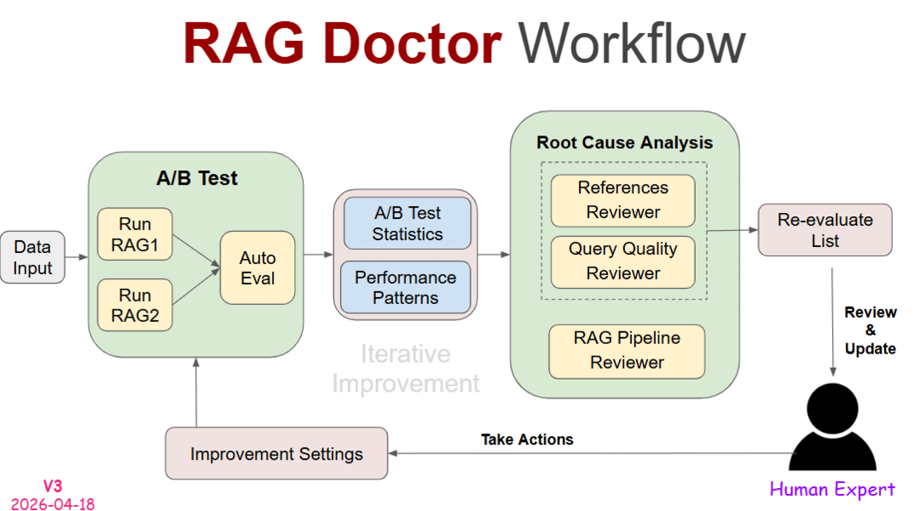

<h1 align="center">RAG Doctor</h1>

<b>Making RAG Reliable for Enterprise Use</b>

## The Challenges
* Most teams don't fail at building RAG. They <b>fail at making it reliable</b>.
* Teams adopt auto eval, but critical decisions still heavily rely on manual review: <b>slow, costly, and inconsistent</b>.
* Existing evaluation and observability tools struggle to adapt as <b>enterprise knowledge continuously evolves</b>.

## What RAG Doctor Does
* ⚡Provide high quality evaluation while reducing up to 90% of manual evaluation, finish RAG A/B tests in minutes (not days).
* 🔍 Traces failures back to their root causes: retrieval, chunking, prompts, grounding, or outdated knowledge.
* 📈 Detects when knowledge base changes invalidate existing ground truth data.
* 🎯 One click delivers insight for both AI teams and business teams.
* 🚀Turn RAG evaluation into a fast, iterative loop
  * 👉 <a href="https://www.youtube.com/watch?v=iH4Po0Qys0o" target="_blank" rel="noopener noreferrer">Check the video demo >></a>
  * 👉 <a href="https://rag-dr.hanhanwu.com/" target="_blank" rel="noopener noreferrer">Try the playground >></a>

  

## Why This Matters
* Built from experience running production RAG systems where evaluation became the bottleneck.
* Auto Evaluation + Root Cause Analysis will become the foundation of enterprise AI.
* RAG Doctor is the first step toward:
  * automated knowledge base optimization
  * auto-generated ground truth datasets
  * self-improving AI systems

## Dev Guide

👉 [Project Setup Guide][1]

[1]:https://github.com/hanhanwu/RagDoctor/blob/main/developer_readme.md
